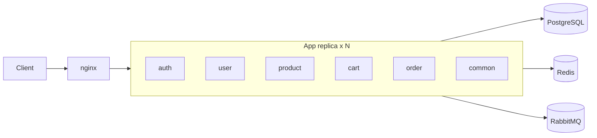
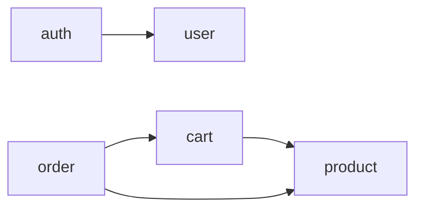

# Kervan

[](https://github.com/Gesch1rr/Kervan/actions/workflows/ci.yml)

Kervan is an e-commerce backend with users, auth, products and categories, cart, and orders. It is a portfolio/CV project built as a modular monolith with Spring Boot to show how one deployable app is designed to scale horizontally and stay correct under concurrency.

## Highlights

- Modular monolith with enforced boundaries: `auth`, `user`, `product`, `cart`, `order`, `common`. `ModularityTest` fails the build on a forbidden dependency or a cycle.
- Checkout correctness under concurrency: conditional stock update plus `CHECK (stock >= 0)`, ordered locks, and one transaction. With 100 buyers and stock 25 across three replicas: exactly 25 orders, 75 rejected, final stock 0.
- Horizontal scaling measured: at 1200 req/s browse p95 is 16 ms on 1 replica and 5 ms on 3. At 2000 req/s one replica is saturated at 357 ms with 16% of load not served, while three replicas serve all at 6 ms.
- Post-commit `OrderCreatedEvent` with an idempotent consumer (`INSERT ... ON CONFLICT DO NOTHING`), 3 retries, then a dead-letter queue.
- Auth with 15-minute JWT access tokens and opaque refresh tokens stored as SHA-256 hashes and rotated on use. Reuse revokes all sessions.
- Tests: 33 unit tests without Docker and 133 integration tests with Testcontainers. Concurrency cases are tested directly, and CI runs `./mvnw verify`.

## Architecture





Modules are top-level packages under `com.eyup.kervan`: `auth`, `user`, `product`, `cart`, `order`, `common`. Allowed dependencies are `auth -> user`, `cart -> product`, `order -> cart` and `product`, and every module -> `common`. Modules only talk through each other's service and DTO packages; a module never touches another module's repository or entities, and cross-module references are plain ids. `ModularityTest` enforces this and fails the build on a forbidden dependency or a cycle.

## Design decisions

1. **Stock is decreased in the database.** Checkout uses `UPDATE ... SET stock = stock - :q WHERE id = :id AND active AND stock >= :q` with a `CHECK (stock >= 0)` constraint, not read-modify-write in Java. PostgreSQL re-checks the condition under the row lock, so concurrent checkouts cannot oversell.

2. **Checkout is one transaction.** It takes an optimistic lock on the cart, verifies products are active, decreases stock in product-id order, creates the order with name and price snapshots, and empties the cart. The same lock order everywhere avoids deadlocks, and any failure rolls everything back.

3. **Order status changes are conditional updates.** Cancel and admin transitions use `UPDATE ... WHERE status IN (...)` with the allowed previous states. Cancelling restores stock once, even with concurrent cancels.

4. **Cart writes use optimistic locking.** A forced version increment makes two devices editing the same cart get a 409 instead of silently overwriting each other.

5. **Events are published after commit.** `OrderCreatedEvent` is published to RabbitMQ only after the transaction commits, and the consumer records the event id with `INSERT ... ON CONFLICT DO NOTHING` in the same transaction as the confirmation, so redelivered messages are handled once. Failed messages are retried 3 times and then go to a dead-letter queue.

6. **Refresh tokens are rotated.** Access tokens are short-lived JWTs (15 min); refresh tokens are opaque, stored only as SHA-256 hashes, and rotated on every use. Reusing an old refresh token revokes all of the user's sessions.

7. **Redis caching evicts after commit.** Product details and the category list are cached with TTLs. Entries are evicted after the transaction commits, and writes are synchronous because Spring Data Redis 4 writes asynchronously by default, which caused stale reads in CI.

8. **Errors use ProblemDetail.** Errors are RFC 9457 ProblemDetail JSON with a stable `code` field, such as `INSUFFICIENT_STOCK` or `ORDER_NOT_CANCELLABLE`.

9. **Lists are paginated and queries are controlled.** Pagination uses a sort-field whitelist. N+1 queries are avoided with entity graphs, checked by tests that count SQL statements.

## API

All endpoints are under `/api/v1`.

| Area | Endpoints | Access |
| --- | --- | --- |
| Auth | `auth`: register, login, refresh, logout | Public register/login; refresh token for refresh/logout |
| Users | `users/me`; admin user list | Authenticated; admin list admin only |
| Categories and products | Category and product reads; admin category and product writes; product search by category or text; admin stock adjustment | Public reads; admin writes |
| Cart | View, add, update, remove, clear | Authenticated user |
| Orders | Checkout, my orders, order detail, cancel | Authenticated user |
| Admin orders | List by status, change status | Admin |

OpenAPI/Swagger UI is available in the dev profile at `/swagger-ui.html`.

## Running locally

1. Install JDK 25+ and Docker.

2. Copy `.env.example` to `.env`:

```bash
cp .env.example .env
```

3. Start the app:

```bash
./mvnw spring-boot:run      # Windows: .\mvnw.cmd spring-boot:run
```

Spring Boot Docker Compose support starts PostgreSQL, Redis, and RabbitMQ from `compose.yaml` automatically. The app runs on http://localhost:8080 with the dev profile. A dev admin is created at startup: `admin@kervan.local` / `admin12345`.

4. Open Swagger UI at http://localhost:8080/swagger-ui.html.

## Tests

`./mvnw test` runs 33 unit tests, including the module boundary check, without Docker. `./mvnw verify` also runs 133 integration tests against real PostgreSQL, Redis, and RabbitMQ via Testcontainers; all integration tests share one Spring context.

Concurrency is tested directly: concurrent checkouts on the last items, opposite lock order, double submit, concurrent cancels, concurrent cart edits, duplicate messages, and poison messages. Key tests were checked by deliberately breaking the code and confirming they fail.

CI (`.github/workflows/ci.yml`, workflow name `CI`) runs `./mvnw verify` on every push and pull request.

## Scaling and load tests

`Dockerfile` and `compose.scale.yaml` run N app replicas behind nginx:

```bash
docker compose -f compose.yaml -f compose.scale.yaml -p kervan-scale up --build --scale app=3
```

The database was seeded with 100k users, 20k products, and 300k orders. Measured on one laptop, each replica limited to 1 CPU:

| Load | 1 replica | 3 replicas |
| --- | --- | --- |
| 1200 req/s: browse p95 | 16 ms | 5 ms |
| 2000 req/s: browse p95 | 357 ms (saturated, 16% of load not served) | 6 ms (all served) |

Stock contention: 100 buyers, stock 25, three replicas -> exactly 25 orders, 75 rejected, final stock 0.

Capacity reasoning: 100k daily users with 10k active in the peak hour is roughly 330 req/s (one request per user every 30 s) to 2,000 req/s (every 5 s). These are laptop numbers, not production numbers.

Details are in [load-tests/README.md](load-tests/README.md).

## Known limits

- No transactional outbox. An event can be lost if RabbitMQ is down right after the commit.
- Product text search has no trigram index.
- No rate limiting on login.
- Expired refresh tokens are not cleaned up by a job.
- With many replicas, a connection pooler such as PgBouncer would be needed.

## Tech stack

Java 25, Spring Boot 4.1, Spring Security (stateless JWT, HS256, resource server), Spring Data JPA / Hibernate 7, PostgreSQL 18, Flyway, Redis 8 (cache), RabbitMQ 4 (events), Spring Modulith 2.1, MapStruct, Lombok, springdoc-openapi, Testcontainers, k6, Docker Compose, nginx, GitHub Actions.
